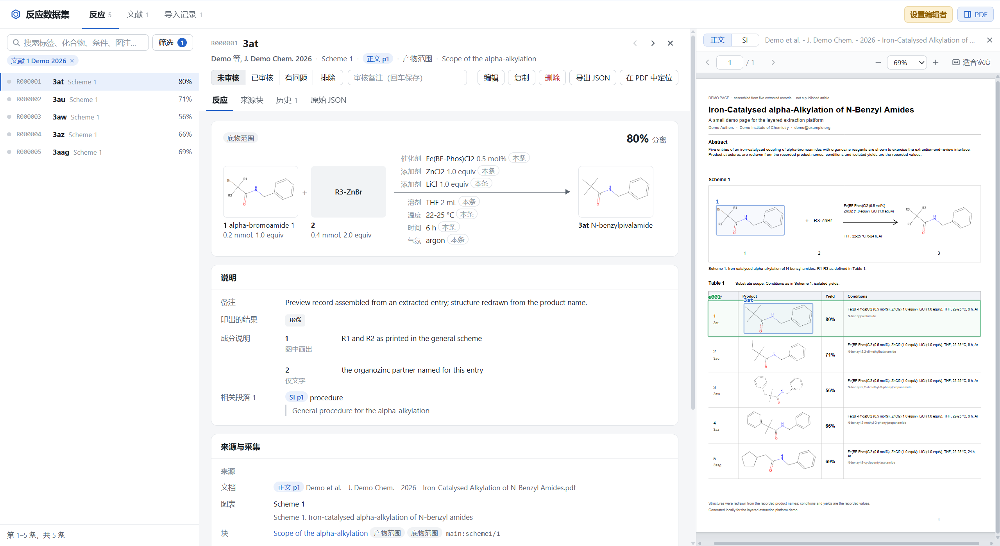

# 面向化学专业文档的分层结构化提取平台

这是一个面向化学论文的提取平台：把“正文 + SI” PDF 中的实验信息逐层抽成结构化反应记录，再交给一套可审核、修订、导出的数据集管理界面。

## 效果展示



上图是审核界面的实际运行效果：左侧为反应列表，中间是一条反应的反应式、条件与产物，右侧 PDF 面板定位到该条目在页面上的框选位置。截图使用 `python -m demo.make` 生成的合成演示数据。

## 分层与模块

| 层 | 模块 | 输入 | 输出 |
| --- | --- | --- | --- |
| 文档层 | `pipeline/steps/s0_preprocess.py` | 正文与 SI 的 PDF | 页面图、带坐标的文本/词/块、缩略图拼版、`manifest.json` |
| 区域层 | `pipeline/steps/s1_locate.py` | 预处理结果、图表标题清单 | `step1/regions.json`，每个区域再切成反应块并标注版式 |
| 块层 | `pipeline/steps/s2_extract.py` 及各版式驱动 | 单个反应块与相关页面 | 条目清单、逐条反应记录、裁图、`step2/reactions.json` |
| 核查层 | `pipeline/consolidate.py` | 一个或多个独立抽取工作区 | 复核后的导入工作区、`raw-records.json`、汇总报告 |
| 数据层 | `curator/` | `work/<paper_id>/` | SQLite 数据集、审核界面、JSON/JSONL/ZIP 导出 |


## 目录

| 路径 | 作用 |
| --- | --- |
| `pipeline/` | 命令行驱动、三个步骤、版式提取器、页面工具、JSON Schema |
| `curator/` | SQLite 存储、导入器、修订日志、HTTP API、前端与 PDF 阅读器 |
| `.agents/skills/` | 交给 Codex 的技能提示词，按“定位 / 各版式条目 / 各版式反应 / 核查 / 汇总”拆分 |
| `.agents/worker-guide.md` | 工作区纪律与页面工具说明，每个模型会话开始时读取 |
| `tests/` | 离线单元测试与测试夹具 |
| `demo/` | 生成一页合成正文、SI 与可导入的工作区 |
| `docs/images/` | README 中的界面截图 |

## 环境准备

需要 Python 3.11 及以上、能够执行 `codex exec` 的 Codex CLI（按本机 `~/.codex/config.toml` 完成认证）。页面工具固定从仓库根目录的 `.venv/bin/python` 启动。

```bash
git clone <this-repo> && cd <this-repo>
python3 -m venv .venv
.venv/bin/pip install -r requirements.txt
codex exec --help   # 确认 CLI 可用；模型与推理强度默认沿用 Codex 配置
```

模型与超时在 `pipeline/config.py` 的 `CodexConfig` 中修改；不填 `model` 与 `reasoning_effort` 时完全沿用本机 Codex 配置。

## 运行示例一：打开审核平台

`demo/` 会生成一页合成正文、一页合成 SI，以及一份可以直接导入的工作区：五条记录取自开发期间使用的一篇铁催化偶联论文，保留其标签、分离产率、条件与产物名称，页面和结构在本地重排、重绘，不包含论文原文。生成物全部位于 `demo-data/`，可以随时删除重建。

```bash
python -m demo.make
python -m curator --db demo-data/db/curator.sqlite import --work demo-data/work
python -m curator --db demo-data/db/curator.sqlite serve
```

打开 <http://127.0.0.1:8791/>，可以看到反应列表、逐条反应式、来源块、修订历史和原始 JSON；右侧 PDF 面板读取入库的 PDF（演示中是本地拼装的合成页面），并按记录中的页码与框渲染结构裁图。数据层没有账号体系，默认只监听本机回环地址。

## 运行示例二：只做文档层预处理

把真实论文按“一篇一个目录”放好，主文件名任意，SI 文件名以 `SI-`、`ESI` 或 `supp` 开头。目录名就是论文编号。

```text
Data/papers/1/Main text.pdf
Data/papers/1/SI-Main text.pdf
```

```bash
python -m pipeline list
python -m pipeline run --papers 1 --steps preprocess
python -m pipeline status
```

`preprocess` 不调用模型，几秒内即可完成。它把每页渲染成 `main/pages/pNNN.png`，把文本层拆成块、词和字符坐标，再生成缩略图拼版，供后续模型会话按需查看。

## 运行示例三：完整抽取一篇论文

`locate` 每篇论文开一次会话；`extract` 按块并发开会话，先用小样本确认提示词与版式，再放开全量。

```bash
# 定位正文里的图、表、段落（SI 用 --docs main si 一并纳入）
python -m pipeline run --papers 1 --steps locate

# 先只读一个块、每个块最多三条，确认输出形状（编号换成 step1/regions.json 里的实际值）
python -m pipeline run --papers 1 --steps extract --blocks main:scheme2/1 --limit 3 -n 2

# 全量抽取
python -m pipeline run --papers 1 --steps extract

python -m pipeline status
```

`--blocks` 接受 `region_id/block_id` 或单独的 `region_id`；`--no-entries` 在块阅读器列出条目后停止，不进入逐条会话；`--kinds` 按块类型筛选。步骤是否跳过取决于版本、参数、PDF 哈希和上游时间戳，改了技能、Schema 或模型就会重跑，没改的部分从缓存继续。

## 运行示例四：两条独立通路做跨文档核查

可以让正文与 SI 各自跑成一条独立通路，再用核查层对照两份结果，复用跨文档证据并汇总实验关系。核查层只读输入工作区，不覆盖原始抽取。

```bash
python -m pipeline --work work-main run --papers 1 --steps preprocess locate extract --docs main
python -m pipeline --work work-si   run --papers 1 --steps preprocess locate extract --docs si

python -m pipeline consolidate \
  --paper 1 \
  --inputs main=work-main si=work-si \
  --output reviewed \
  --batch-size 8 --max-pages 6 --max-calls 10
```

核查产物是标准的 `reviewed/1/` 工作区，可直接入库：

```bash
python -m curator --db db/curator.sqlite import --work reviewed
```

`--max-calls` 是本次核查允许新开的模型调用上限，达到上限会停在断点；`--review-limit` 只用于小样本试跑，结果会标记为部分完成。已有回答可用 `--republish` 重新校验并重建产物，不产生新的模型调用。

## 运行示例五：数据集管理与导出

下面的命令使用仓库内的默认路径（`work/` 与 `db/curator.sqlite`）；如果接着示例一操作，把 `--db` 与 `work` 换成 `demo-data/` 下的对应路径即可。

```bash
# 导入、查看状态
python -m curator import
python -m curator check
python -m curator serve

# 按条导出 JSONL，或带结构裁图的 ZIP
python -m curator export --out export.jsonl
python -m curator export --out export.zip --images --status reviewed

# 运行中也可以做一致性备份
python -m curator backup --out backup/curator-$(date +%F).sqlite
```

导入是幂等的：同一篇论文再次导入会替换它的反应，旧版本保留为只读历史，人工审核、备注和修订不会被覆盖。`check` 在读事务里核对修订链、快照、PDF 哈希和导入归属；`backup` 用 `VACUUM INTO` 生成一致副本，不要直接复制正在服务的 SQLite 主文件。

审核界面之外的接口同样是普通 HTTP JSON API，例如 `GET /api/papers`、`GET /api/reactions?paper=1`、`GET /api/reactions/<id>`、`GET /api/docs/<doc_id>/render?page=1&bbox=x0,y0,x1,y1`、`POST /api/reactions/<id>/review`。写请求要求 JSON、同源 `Origin` 和正确的 `Host`，用于阻止跨站表单与 DNS rebinding。

## 运行示例六：测试

```bash
.venv/bin/python -m unittest discover -s tests
```

整套测试不调用模型、不访问网络，约二十秒完成，覆盖页面几何、各版式提取、合并校验、数据库修订链、导入导出、演示数据生成与 HTTP 接口。

## 输出格式

每个工作区是 `work/<paper_id>/`，其中 `paper.json` 记录文档哈希与每个步骤的状态、版本、参数和摘要，`main/`、`si/` 是预处理产物，`step1/regions.json` 是区域清单，`step2/reactions.json` 是反应记录，`step2/blocks/<region>__<block>/view.json` 是单块视图，`logs/` 保留原始模型事件流。页码从 1 开始；所有框都是 PDF 坐标下的 `[x0, y0, x1, y1]`，原点在左上角。

一条反应记录包含 `reaction_id`（形如 `main:scheme2/1/e001-3`）、印刷标签、类型、条件套、印刷结果、推断、来源（文档、页、图、条目、框、裁图）以及若干 `steps`。每个步骤的 `reactants`、`products`、`conditions` 都带 `page`、`bbox`、`crop`、`source`、变量与推断标记；`outcomes` 中的产率区分 `isolated`、`NMR`、`GC` 等类型，保留印刷原文与可解析数值。质检字段 `issues` 与 `warnings` 是给审核人员看的疑点。

## 修改提示词与规则

模型看到的内容全部在仓库里：技能在 `.agents/skills/`，公共抽取规则在 `.agents/shared/extract-core.md`，页面工具说明在工作区指南 `.agents/worker-guide.md`，输出契约在 `pipeline/schemas/*.schema.json`，生成 Schema 的脚本是 `pipeline/schemas/build_extract.py`。修改这些文件会改变下一次运行的结果，也会改变步骤缓存身份；不要在小改动后假设可以复用整篇旧结果。Python 侧的校验、几何检查与合并逻辑在各 `pipeline/extract_*.py` 中，改动输出时同时提升对应步骤的 `VERSION`。

## 边界与限制

模型调用会产生真实费用与时间开销，定位与抽取的会话可能需要数分钟到数小时；先用 `--blocks`、`--limit` 或者 `--no-entries` 做小样本确认。抽取结果需要化学专业人员复核，程序完成校验不代表化学结论正确。仓库内不附带论文 PDF，请使用你有权处理的文档，并遵守相应出版许可。

## 许可

MIT License，见 [LICENSE](LICENSE)。
